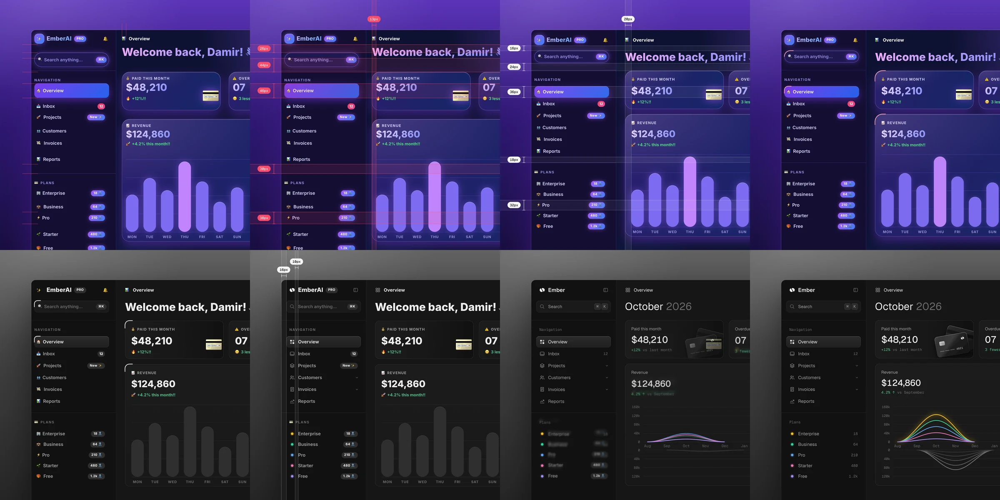

# unslop-portable

> **This is an unofficial port.** It is not affiliated with, endorsed by, or supported by the original author. The canonical skill is [heydamir/unslop](https://github.com/heydamir/unslop) — install that one if you want the upstream version. This port exists because the skill only shipped for Claude Code, and it is published under the same CC BY 4.0 terms with the original credit kept.

A portable build of [heydamir/unslop](https://github.com/heydamir/unslop) that works in Claude Code, OpenAI Codex, opencode, Google Antigravity and any other agent that reads the `SKILL.md` open format.

unslop turns vibecoded, AI-looking UI into a designed interface with its own character. It finds the slop first — the purple gradients, glows, emoji labels, shouty copy and uneven spacing — then sets a direction from your product and fixes the screen pass by pass, like a designer doing a redline review. It works in whatever your screen is built with: Next.js, React, Vue, Svelte, Tailwind or plain HTML and CSS, on dashboards, apps and landing pages, and even on a live site when all you have is a link.



## Install

One command installs the skill once under `~/.agents/skills/unslop-portable` and links it into every agent's skills folder:

**Windows (PowerShell)**

```powershell
git clone https://github.com/ardaozyildirim/unslop-portable
cd unslop-portable
powershell -ExecutionPolicy Bypass -File .\install.ps1
```

**macOS / Linux**

```bash
git clone https://github.com/ardaozyildirim/unslop-portable
cd unslop-portable
./install.sh
```

Or place the folder yourself:

| Agent | Folder |
| --- | --- |
| Claude Code | `~/.claude/skills/unslop-portable/SKILL.md` |
| OpenAI Codex | `~/.codex/skills/unslop-portable/SKILL.md` |
| opencode | `~/.config/opencode/skills/unslop-portable/SKILL.md` |
| Google Antigravity | `~/.gemini/antigravity-cli/skills/unslop-portable/SKILL.md` |

The skill is named `unslop-portable` on purpose. The upstream skill is named `unslop`, and two skills cannot share a name: installing both would make one overwrite the other, and the two would fight over the same slash command. With a distinct name both live side by side.

The installer takes a few options:

| Option (`install.ps1`) | What it does |
| --- | --- |
| `--update` (`-Update`) | Refresh the installed copy and the Antigravity copies. Run it after pulling a new version, because Antigravity copies the files instead of linking them. |
| `--uninstall` (`-Uninstall`) | Remove the installed copy, the links and the copies. |
| `--dry-run` (`-DryRun`) | Print what would happen without changing anything. |

Earlier builds of this port used the name `unslop`. The installer removes those folders only when they are clearly this port. It never touches the upstream `unslop` skill, so both can stay installed side by side.

## Use it

- **Claude Code.** Type `/unslop-portable` and name the screen, or just ask in your own words.
- **OpenAI Codex, opencode, Antigravity.** Name the skill in the request, like `use the unslop-portable skill on this dashboard`, and point at the screen.

The screen can be a file path, a live URL, or a screenshot.

## Requirements for the scripts

`scripts/snapshot.mjs` and `scripts/story.mjs` need Node 18 or newer and [Playwright](https://playwright.dev) (`npm install -D playwright`, then `npx playwright install chromium`). They use an installed Chrome, Chromium or Edge when they find one (set `CHROME_PATH` to point at a specific browser), otherwise Playwright's own Chromium. The story video also needs `ffmpeg`.

## What this port changes

The method is unchanged. The reference files, the examples and the LICENSE are taken from upstream as they are; the commit they match is recorded in [`UPSTREAM`](UPSTREAM) and the changes made here are listed in [CHANGELOG.md](CHANGELOG.md). This port adds the things upstream needed to exist outside Claude Code:

- **Cross-agent install.** `install.sh` and `install.ps1` link the skill into the Claude Code, Codex, opencode and Antigravity folders. Antigravity gets a real copy instead of a link, because it does not follow symlinks.
- **Windows browser discovery.** `scripts/snapshot.mjs` and `scripts/story.mjs` find Chrome and Edge on Windows, and look for `google-chrome-stable` and `chromium-browser` on Linux.
- **Agent-neutral front matter.** The `compatibility` field and the "Using this skill" section describe how to invoke the skill in each agent.
- **Repo tooling.** `scripts/sync-upstream.sh`, `scripts/validate.mjs`, CI, and upstream's script tests, adapted to the new folder name. None of it is part of the installed skill.
- **A distinct name.** The skill, the folder and the repository are called `unslop-portable`, so it can live next to upstream `unslop` without a collision. `CITATION.cff` credits both Damir Sokolovsky and this port, and points at the upstream repository.

Everything else is upstream's work, kept intact.

## Keeping it in sync with upstream

The skill follows upstream through a script, and a weekly workflow runs the same script and opens a pull request when upstream has moved:

```bash
scripts/sync-upstream.sh --check   # report only
scripts/sync-upstream.sh           # branch sync/upstream-<sha> with the skill changes applied
```

It maps upstream's `skills/unslop/` onto `skills/unslop-portable/` and records the absorbed commit in [`UPSTREAM`](UPSTREAM). Conflicts with the port's own changes (the `SKILL.md` header, the browser discovery in the scripts) are left as conflict markers to resolve by hand. Upstream changes outside `skills/` (README, LICENSE, examples) are not synced automatically.

## Contributing

Problems with the method, the passes or the references belong [upstream](https://github.com/heydamir/unslop/issues). Problems with the installers, the agent folders or the sync belong here. Run `node scripts/validate.mjs` before opening a pull request; it also checks that the credit, the license and the notice of changes are still in place.

## Credits

unslop was created by Damir Sokolovsky ([@heydamir](https://x.com/heydamir)) and is licensed under [CC BY 4.0](LICENSE). Use it, change it and share it, including commercially, as long as you credit Damir Sokolovsky and link back to [the original repository](https://github.com/heydamir/unslop). This port by [@ardaozyildirim](https://github.com/ardaozyildirim).

The portable build for Claude Code, OpenAI Codex, opencode and Google Antigravity was written by [@ardaozyildirim](https://github.com/ardaozyildirim). The method is unchanged.
